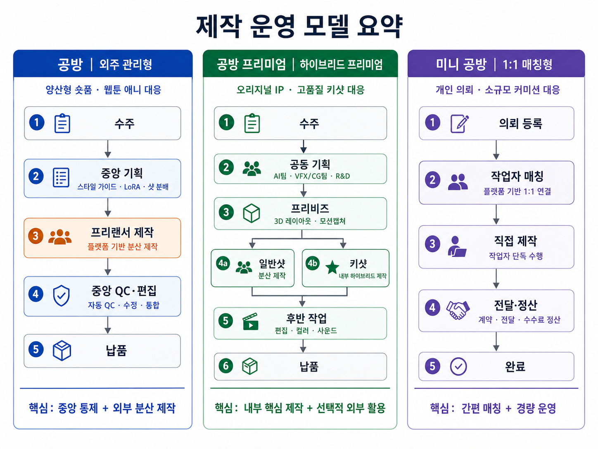
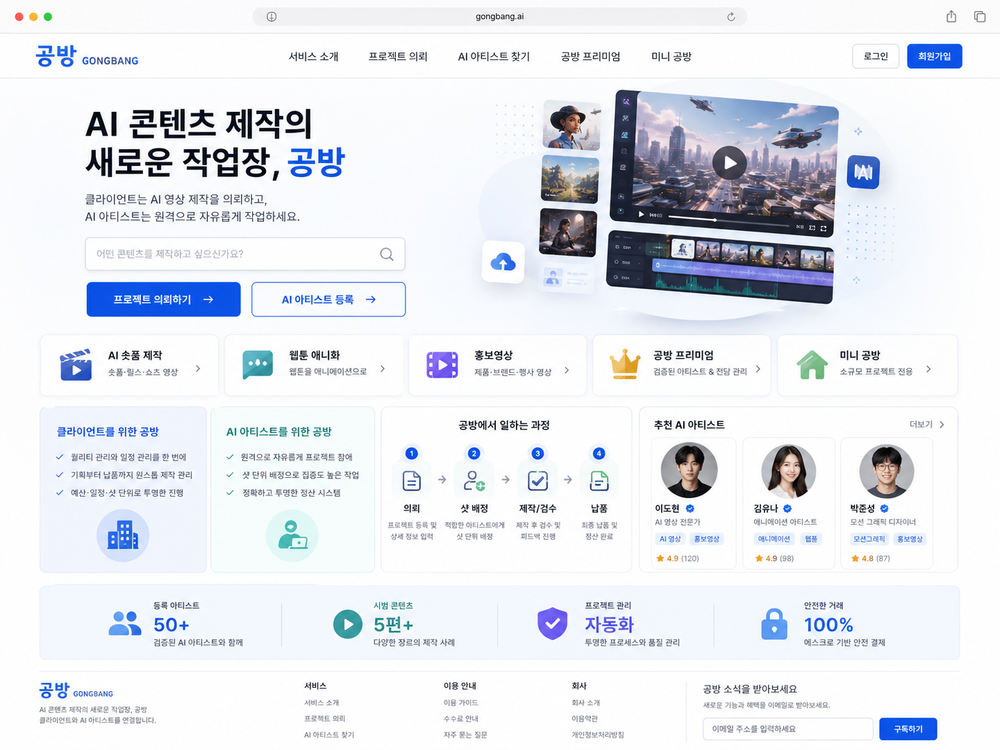
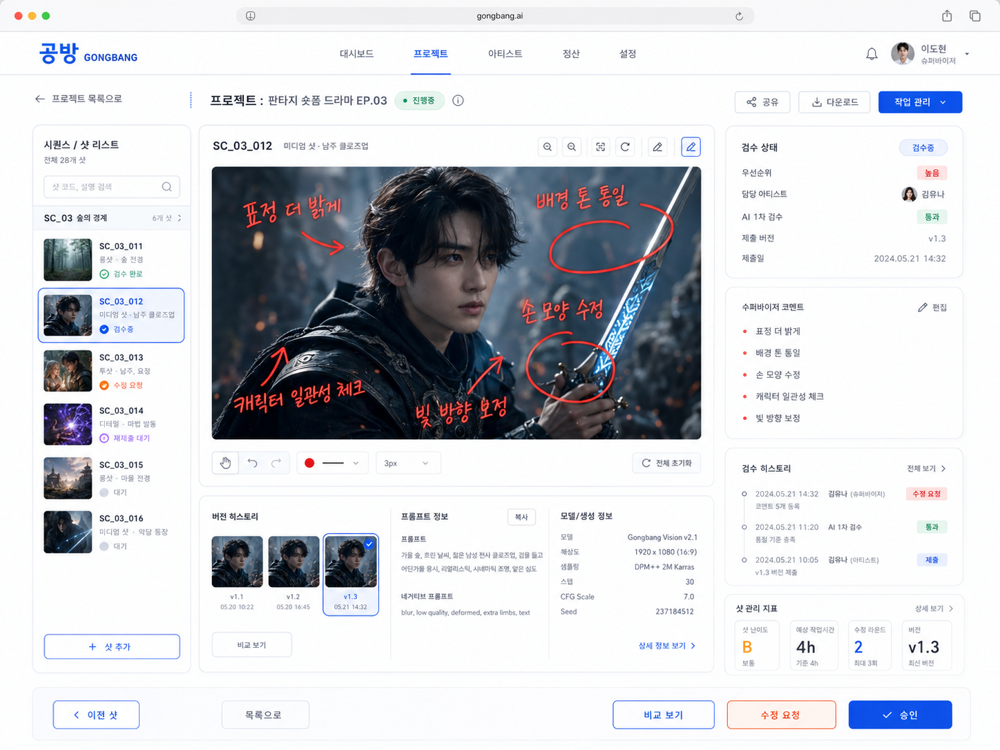

# GONGBANG (공방) — AI 생성형 콘텐츠 제작 운영 플랫폼 기획

> **Working Title**: GONGBANG (공방)  
> **개요**: 외부 AI 아티스트 네트워크를 기반으로 샷 단위 분산 제작과 AI 기반 품질·일정·정산 관리를 통합하는 **AI 콘텐츠 제작 운영 플랫폼** 사업 기획안

---

## 프로젝트 소개

**공방(GONGBANG)**은 숏폼 드라마, 웹툰 IP 영상화, 홍보영상, AI 영화·애니메이션 등 급성장하는 AI 영상 제작 수요에 대응하기 위한 가변형 제작 관리 플랫폼입니다.

* **AI 기반 운영 자동화**: 샷 난이도 분류, 아티스트 역량 매칭, 일정 추천, 1차 품질 검수(QC) 자동화
* **비주얼 일관성 관리**: 다수의 재택 AI 아티스트가 작업한 결과물을 단일 작품 톤앤매너로 통합
* **AI+VFX 하이브리드 파이프라인**: 일반 샷의 AI 분산 제작과 고난도 키샷의 인하우스 VFX 역량 결합

### 서비스 라인업

| 서비스 | 대상 | 수익 모델 |
| :--- | :--- | :--- |
| **공방 (Standard)** | 양산형 AI 숏폼, 웹툰 애니화, 홍보영상 | 제작비 내 아티스트 지급액·운영비를 제외한 제작관리 마진 |
| **공방 프리미엄** | 고품질 AI 영화·애니메이션, 프리미엄 IP 영상화 | 검증된 AI 작업자 풀 + 인하우스 AI/VFX 결합 고단가 프로젝트 |
| **미니 공방** | 개인·소규모 AI 콘텐츠 의뢰 | 의뢰자–작업자 1:1 매칭 및 거래 수수료 |

---

## 주요 문서 및 파일 구성

| 파일명 | 설명 |
| :--- | :--- |
| [`gongbang_plan.md`](./gongbang_plan.md) | 공방(GONGBANG) 사업 기획안 전문 (Markdown, v8) |
| [`gongbang_plan.pdf`](./gongbang_plan.pdf) | 공방(GONGBANG) 사업 기획안 PDF 버전 |
| [`gongbang_presentation.pdf`](./gongbang_presentation.pdf) | 공방(GONGBANG) 발표자료 PDF |
| [`gongbang_workflow.png`](./gongbang_workflow.png) | 플랫폼 제작 및 운영 워크플로우 다이어그램 |
| [`gongbang_concept_01.png`](./gongbang_concept_01.png) | 플랫폼 컨셉 이미지 01 |
| [`gongbang_concept_02.png`](./gongbang_concept_02.png) | 플랫폼 컨셉 이미지 02 |
| [`gongbang_concept_03.png`](./gongbang_concept_03.png) | 플랫폼 컨셉 이미지 03 |

---

## 워크플로우 및 컨셉 프리뷰

### 워크플로우

### 플랫폼 컨셉 이미지
| Concept 01 | Concept 02 | Concept 03 |
| :---: | :---: | :---: |
|  |  |  |
